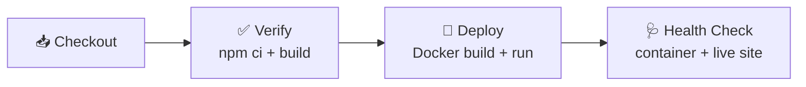

<div align="center">

[](https://git.io/typing-svg)

<br/>

[](https://shreyasportfolio.hopto.org/)


</div>

---

## 💫 About the Project

```ts
const portfolio = {
  owner:     "Shreyas Vikrant Dewangswami",
  type:      "Personal Developer Portfolio",
  frontend:  ["React 19", "TypeScript", "Vite"],
  backend:   "ASP.NET Core API (Quote of the Day)",
  devops:    ["Docker", "Nginx", "Jenkins CI/CD"],
  testing:   ["Vitest", "React Testing Library"],
  analytics: "Umami (optional, privacy-first)",
  live:      "https://shreyasportfolio.hopto.org",
}
```

---

## ✨ Features

<div align="center">

| 🎨 Design | ⚡ Functionality | 🔁 DevOps |
|:---:|:---:|:---:|
| Fully responsive layout | Live Quote of the Day API | Multi-stage Docker build |
| Light & dark themes | Typed fetch client with `AbortSignal` | Nginx static hosting |
| No theme flash on load | Hero, About, Journey, Skills, Projects, Contact | Jenkins CI/CD pipeline |
| Scroll-reveal animations | Privacy-first Umami analytics | Automated health checks |
| Respects reduced motion | Vitest + Testing Library tests | Versioned Docker images |

</div>

---

## 💻 Tech Stack

### 🖥️ Frontend

<div align="center">

[](https://skillicons.dev)

</div>


### 🧪 Testing & Code Quality


### 🐳 DevOps & Deployment

<div align="center">

[](https://skillicons.dev)

</div>

### ⚙️ Backend & Analytics

<div align="center">

[](https://skillicons.dev)

</div>


---

## 🚀 Getting Started

> **Prerequisites:** Node.js 24+, npm, and the backend API running locally for live quotes. Docker is optional.

```bash
# 1. Clone the repo
git clone https://github.com/dewangshree/shreyas-portfolio-web.git
cd shreyas-portfolio-web

# 2. Install dependencies
npm install

# 3. Start the dev server
npm run dev
```

### 📜 Scripts

| Command | What it does |
|:---|:---|
| `npm run dev` | ⚡ Start the Vite dev server |
| `npm run build` | 🏗️ Type-check with `tsc` and build for production |
| `npm run preview` | 👀 Preview the production build |
| `npm test` | 🧪 Run tests with Vitest |
| `npm run lint` | 🧹 Lint with Oxlint |

---

## 🔧 Configuration

| Variable | Default | Purpose |
|:---|:---|:---|
| `VITE_API_PROXY_TARGET` | `http://localhost:5213` | Backend address for the dev proxy |
| `VITE_API_BASE_URL` | Same origin | Base URL for API requests |
| `VITE_UMAMI_WEBSITE_ID` | — | Umami website ID (enables analytics) |
| `VITE_UMAMI_SCRIPT_URL` | — | Umami tracking script URL |

---

## 🔗 Backend Integration

The Quote of the Day calls one endpoint on the companion ASP.NET Core API:

```http
GET /api/quotes/today
```

```ts
interface Quote {
  text: string
  author: string
  date: string
  source: string
}
```

In development, Vite proxies `/api` to `http://localhost:5213`. To use another address, add it to `.env.local`:

```bash
VITE_API_PROXY_TARGET=http://localhost:5000
```

---

## 🔁 CI/CD Pipeline



| Stage | What happens |
|:---|:---|
| 📥 **Checkout** | Pulls the latest source code |
| ✅ **Verify** | Installs dependencies and runs a production build |
| 🐳 **Deploy** | Syncs code to the server, builds a Docker image tagged with the build number, and swaps the running container |
| 🩺 **Health Check** | Confirms the container and the public site both respond |

### 🐳 Run with Docker

```bash
docker build -t shreyas-portfolio-frontend .
docker run -d -p 8080:80 shreyas-portfolio-frontend
```

Open **http://localhost:8080** 🎉

---

## 🗂️ Project Structure

```text
.
├── public/images/           # 🖼️ Profile photo & section backgrounds
├── src/
│   ├── components/          # 🧩 Hero, About, Journey, Skills, Projects,
│   │                        #    Contact, Header, Footer, QuoteOfTheDay
│   ├── hooks/               # 🪝 useScrollReveal
│   ├── services/            # 🌐 Quote API client & analytics
│   ├── styles/              # 🎨 Global styles
│   ├── test/                # 🧪 Vitest setup
│   ├── types/               # 📐 API contracts
│   ├── App.tsx
│   └── main.tsx
├── Dockerfile               # 🐳 Multi-stage build
├── Jenkinsfile              # 🔁 CI/CD pipeline
├── nginx.conf               # 🌐 SPA routing
└── vite.config.ts           # ⚡ Vite, proxy & test config
```

---

## 🔒 Analytics & Privacy

Analytics are **off by default** and turn on only when both Umami variables are set.

| ✅ Tracked | ❌ Not tracked |
|:---|:---|
| Page views (total & unique) | Personal visitor data |
| `project-click` events (project name + `card` / `github` / `live`) | Interview interactions |

---

<div align="center">

### 🌐 Connect With Me

[](https://www.linkedin.com/in/Shreyas-Dewangswami)
[](https://github.com/dewangshree)
[](mailto:shreyasdewangswami17@gmail.com)

**Building systems that actually ship** 🚀

⭐ Star this repo if you like it!


</div>
